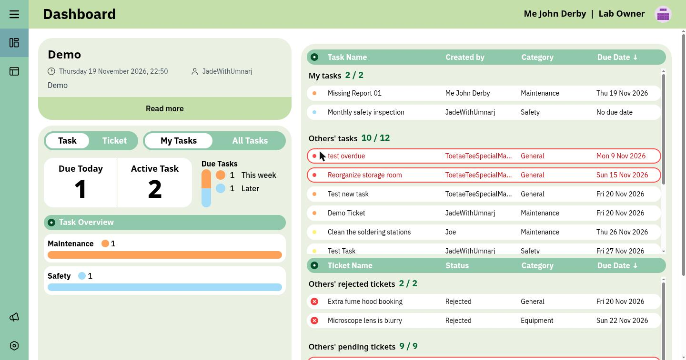

<p align="center">
  
</p>

<h1 align="center">Labrador</h1>

<p align="center">
  Lab workflow &amp; request management — Next.js frontend, FastAPI backend, Supabase.
</p>

<p align="center">
  
  <br />
  <em>The live Labrador dashboard.</em>
</p>

---

**Course:** Individual Software Development Process' 2026 \
**Team:** Wassawin the Goat of All Time (W-GOAT) \
**Chosen IRL Challenge:** Project B Lab Workflow & Request Management

## Team members

| Name                     | Student ID | GitHub                                              |
| ------------------------ | ---------- | --------------------------------------------------- |
| Kantinan Lertluckpreecha | 6810545476 | [LELOUCH2L](https://github.com/LELOUCH2L)           |
| Jedsada Ungsunantwiwat   | 6810545522 | [Jadeung123](https://github.com/Jadeung123)         |
| Pathadon Aougsk          | 6810545808 | [PathadonAougsk](https://github.com/PathadonAougsk) |
| Wassawin Swangjaeng      | 6810545905 | [CYRTRUS](https://github.com/CYRTRUS)               |
| Siraphob Phonphakdee     | 6810545930 | [vaporform](https://github.com/vaporform)           |

## Documents & diagrams

Everything lives in [`docs/`](docs).

### Iteration reports

| Iteration | Report                                                                                          |
| --------- | ----------------------------------------------------------------------------------------------- |
| 1         | [ISP-SKE26 Iteration Report 1 W-GOAT.pdf](docs/ISP-SKE26%20Iteration%20Report%201%20W-GOAT.pdf) |
| 2         | [ISP-SKE26 Iteration Report 2 W-GOAT.pdf](docs/ISP-SKE26%20Iteration%20Report%202%20W-GOAT.pdf) |
| 3         | [ISP-SKE26 Iteration Report 3 W-GOAT.pdf](docs/ISP-SKE26%20Iteration%20Report%203%20W-GOAT.pdf) |
| 4         | [ISP-SKE26 Iteration Report 4 W-GOAT.pdf](docs/ISP-SKE26%20Iteration%20Report%204%20W-GOAT.pdf) |
| 5         | [ISP-SKE26 Iteration Report 5 W-GOAT.pdf](docs/ISP-SKE26%20Iteration%20Report%205%20W-GOAT.pdf) |

### Specs & diagrams

| File / folder                                                  | Contents                           |
| -------------------------------------------------------------- | ---------------------------------- |
| `docs/ISP-SKE-26 3 Wassawin the Goat of All Time (W-GOAT).pdf` | Software Requirement Specification |
| `docs/use_case_diagram/`                                       | Use case diagram                   |
| `docs/sequence_diagram/`                                       | Sequence diagrams (SQD-1 … SQD-7)  |
| `docs/activity_diagram/`                                       | Activity diagrams (AD-1 … AD-6)    |
| `docs/gantt_chart/`                                            | Project Gantt chart                |

## Stack

| Compose service | Role                               | Port |
| --------------- | ---------------------------------- | ---- |
| `nextjs`        | Next.js frontend                   | 3000 |
| `fastapi`       | FastAPI backend                    | 8000 |
| `tunnel`        | Cloudflare Tunnel (prod, optional) | —    |

Data and auth are hosted on Supabase. API docs are served at `http://localhost:8000/docs`.

| Compose file               | Purpose                                                      |
| -------------------------- | ------------------------------------------------------------ |
| `docker-compose.dev.yaml`  | Local development — source bind-mounted, hot reload          |
| `docker-compose.prod.yaml` | Production — built images, multi-worker server, auto-restart |

## Prerequisites

- [Docker Engine](https://docs.docker.com/engine/install/) 20.10+ with Docker Compose v2 (`docker compose`, with a space)
- A Supabase project (URL, anon key, service key, DB connection string)

Node.js and Python are **not** needed on your machine — both run in containers.

```bash
docker --version
docker compose version
```

## 1. Clone and configure

```bash
git clone https://github.com/PathadonAougsk/ISP.git
cd ISP
cp source/.env.sample source/.env
```

Fill in `source/.env`. It is the **only** env file; both services and both compose files read it. It's gitignored, so a fresh clone won't have one.

| Key                             | Used by        | Notes                                                         |
| ------------------------------- | -------------- | ------------------------------------------------------------- |
| `SUPABASE_URL`                  | backend        | Project URL                                                   |
| `SUPABASE_KEY`                  | backend        | Service-role/secret key — server-side only                    |
| `SUPABASE_DB_URL`               | backend        | `postgresql+asyncpg://…` connection string                    |
| `SUPABASE_JWT_SECRET`           | backend        | Optional, legacy HS256 projects only                          |
| `NEXT_PUBLIC_SUPABASE_URL`      | frontend       | Same URL as above                                             |
| `NEXT_PUBLIC_SUPABASE_ANON_KEY` | frontend       | Publishable/anon key                                          |
| `NEXT_PUBLIC_API_URL`           | frontend       | `http://localhost:8000` locally; your public API URL in prod  |
| `CORS_ORIGINS`                  | backend (prod) | Comma-separated allowed origins, default `http://localhost:3000` |
| `WEB_CONCURRENCY`               | backend (prod) | Server workers, default `2`                                   |
| `TUNNEL_TOKEN`                  | tunnel (prod)  | Cloudflare Tunnel token, only with `--profile tunnel`         |

> Anything prefixed `NEXT_PUBLIC_` ends up in the browser bundle. Never put a secret behind that prefix.

## 2. Run locally (development)

```bash
docker compose -f docker-compose.dev.yaml --env-file source/.env up -d
```

The first run builds both images and takes a few minutes. Then open:

- Frontend: <http://localhost:3000>
- Backend: <http://localhost:8000> (health check at `/health`)
- Swagger UI: <http://localhost:8000/docs>

Source folders are bind-mounted, so saving a file hot-reloads inside the container. Rebuild only after changing a `Dockerfile*`, `package.json`, or Python dependencies:

```bash
docker compose -f docker-compose.dev.yaml --env-file source/.env up -d --build
```

Handy commands (run `export COMPOSE_FILE=docker-compose.dev.yaml` once so you can drop the `-f`):

```bash
docker compose ps                         # status
docker compose logs -f                    # all logs
docker compose logs -f fastapi            # one service
docker compose exec fastapi bash          # shell into the backend
docker compose exec nextjs sh             # shell into the frontend
docker compose exec nextjs npm install <package>
docker compose exec fastapi pytest        # backend tests
docker compose down                       # stop and remove
docker compose down -v                    # also clear node_modules/.next volumes
```

## 3. Run in production

`docker-compose.prod.yaml` builds a Next.js standalone server and runs the backend with `fastapi run` on several workers as a non-root user. Both have health checks and restart automatically.

```bash
# on the server
git clone https://github.com/PathadonAougsk/ISP.git
cd ISP
cp source/.env.sample source/.env   # then fill in production values

docker compose -f docker-compose.prod.yaml --env-file source/.env up -d --build
```

`--env-file source/.env` is required: the `NEXT_PUBLIC_*` values are baked into the frontend at **build** time, so compose must read them before building. After changing any `NEXT_PUBLIC_*` value, rebuild with `--build`.

Check that it's healthy:

```bash
docker compose -f docker-compose.prod.yaml ps
curl -f http://localhost:8000/health
```

### Exposing it with Cloudflare Tunnel (optional)

The `tunnel` service publishes the app without opening inbound ports, which works even behind NAT/CGNAT.

1. Create a Named Tunnel in Cloudflare Zero Trust → Networks → Tunnels, and put its token in `source/.env` as `TUNNEL_TOKEN`.
2. Add public hostnames to the tunnel that point at the compose service names:
   - `app.<your-domain>` → `http://nextjs:3000`
   - `api.<your-domain>` → `http://fastapi:8000`
3. In `source/.env`, set `NEXT_PUBLIC_API_URL=https://api.<your-domain>` and `CORS_ORIGINS=https://app.<your-domain>`.
4. Add `https://app.<your-domain>` to the Supabase Auth redirect URLs.
5. Start everything with the tunnel profile:

```bash
docker compose -f docker-compose.prod.yaml --env-file source/.env --profile tunnel up -d --build
```

### Updating production

```bash
git pull
docker compose -f docker-compose.prod.yaml --env-file source/.env --profile tunnel up -d --build
```

## How the services talk to each other

- **From the browser** (client-side fetches): use `NEXT_PUBLIC_API_URL` — `http://localhost:8000` locally.
- **From inside a container** (SSR, server components): use `http://fastapi:8000`. Compose resolves service names as hostnames; `localhost` inside a container means that container.

## Troubleshooting

**`env file ./source/.env not found`** or **`set in source/.env`**: you skipped step 1, or left out `--env-file source/.env`.

**Port 3000 or 8000 already in use**: stop whatever holds it, or change the left side of the port mapping in the compose file.

**Frontend can't reach the backend**: check whether the call runs in the browser or on the server, and use the matching hostname above. In prod, also check `CORS_ORIGINS`.

**Changed a `NEXT_PUBLIC_*` value but prod didn't pick it up**: those are build-time values; rerun with `--build`.

**`Cannot find module` after adding a frontend dependency (dev)**: install it inside the container, or rebuild with `--build`.

**Something is deeply stuck**: `docker compose -f docker-compose.dev.yaml down -v`, then bring it back up with `--build`.

## Notes

- `source/.env.sample` is committed (an exception to the `.env*` gitignore rule). Keep it in sync when you add a key.
- CI builds both Docker images on every pull request to `main` (`.github/workflows/Docker-build-check.yml`).
